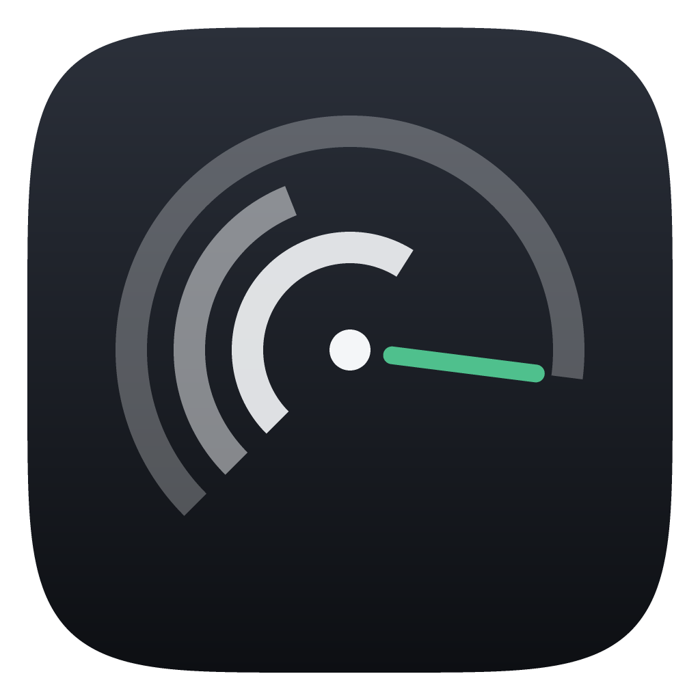
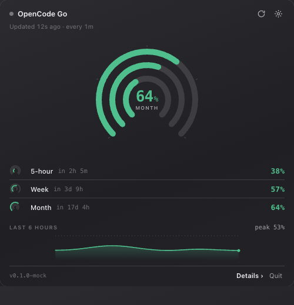
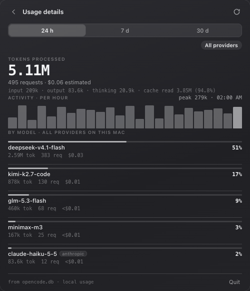
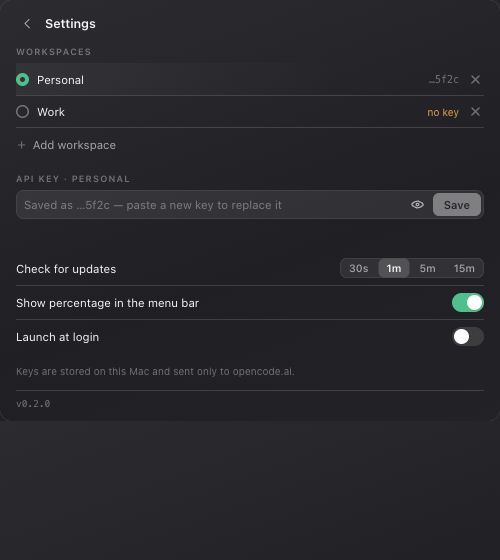

<p align="center">
  
</p>

<h1 align="center">OpenCode Go Usage</h1>

<p align="center">
  A menu bar meter for your OpenCode Go plan — the 5-hour, weekly and monthly
  limits at a glance, plus the token detail behind them.
</p>

<p align="center">
  <a href="https://github.com/hirawat-ll/opencode-go-usage/releases/latest"></a>
  
  
  
  
</p>

<p align="center">
  
  
</p>

---

OpenCode Go subscriptions have three limits that reset on different clocks and
only exist as percentages inside the console. This puts them in your menu bar,
warns you with colour before a limit bites, and reads the token detail out of
OpenCode's own database when you want to know what actually consumed the plan.

It is a [Tauri 2](https://v2.tauri.app/) app: a Rust core (polling, tray, SQLite
reads, window behaviour) and a small plain-TypeScript panel — no framework, no
runtime dependencies in the UI, ~6 MB on disk.

## Highlights

- **Triple ring gauge.** One arc per limit, horizon growing outward: 5-hour
  inside, week in the middle, month outside. The centre names whichever window is
  closest to its limit, and the menu bar carries that same number.
- **Severity, not decoration.** Green under 70%, amber from 70%, coral from 90% —
  or whenever the API reports a window as spent.
- **Failures never blank the panel.** The last good reading stays on screen,
  marked stale, with a strip that says what happened: rejected key, no Go plan,
  unreachable, unexpected response.
- **Token detail from the local database** — models, tokens, requests, estimated
  cost over 24 h / 7 d / 30 d, with the cache-hit share and a **Go models only**
  filter, so you can see why a big token count sits against a small percentage.
- **Multiple workspaces.** A list of keys with names, one active at a time;
  percentages from different limits are never added together.
- **Launch at login** as a proper macOS login item — registered through
  ServiceManagement, so System Settings lists the app's name and icon rather than
  an anonymous background agent. Items created by earlier versions are migrated.

## Install

Download the latest `.dmg` from
[Releases](https://github.com/hirawat-ll/opencode-go-usage/releases/latest), drag
the app to `/Applications`, and paste a Go API key into Settings.

The build is ad-hoc signed, so macOS quarantines it on first launch:

```sh
xattr -dr com.apple.quarantine "/Applications/OpenCode Go Usage.app"
```

or right-click the app → **Open** once. Then, in the app: **Settings → Launch at
login** if you want it running with the Mac.

Getting a key: subscribe to Go or Go Plus in the
[OpenCode Console](https://opencode.ai/console), copy the workspace key, paste it
into the app's Settings.

## Using it

- **Left click** the menu bar icon to open the panel, click away to dismiss.
- **Right click** for *Check now*, *Usage details…*, *Settings…*, *Quit*.
- **⌘R** checks now · **⌘D** details · **⌘,** settings · **Esc** dismisses.
- The menu bar number is whatever window is closest to its limit; turn it off in
  Settings if you prefer the bare icon.

<table>
<tr>
<td width="50%"></td>
<td valign="top">

**Settings** holds the workspaces, the key for the active one, how often to
check, and whether the percentage shows in the menu bar.

Each workspace keeps its own reading and its own six hours of samples, so
switching is instant. Only the active workspace is polled on the interval; the
others refresh when you switch to them — the request rate does not grow with the
number of keys. API keys are never sent to the panel; it only ever receives a
masked tail like `…a91f`.

</td>
</tr>
</table>

## How it works

Every `pollSeconds` (default 60) the app calls the Go usage endpoint:

```
GET https://opencode.ai/zen/go/v1/usage
Authorization: Bearer <your key>
```

```json
{ "usage": {
    "rolling": { "status": "ok", "percent": 47, "resetsAt": "2026-10-12T18:41:00Z" },
    "weekly":  { "status": "ok", "percent": 31, "resetsAt": "..." },
    "monthly": { "status": "ok", "percent": 6,  "resetsAt": "..." } } }
```

The endpoint reports plan percentages, not tokens, so the **details view reads a
second source**: OpenCode's own SQLite database (`~/.local/share/opencode/`,
opened read-only), where every assistant message records its model, token counts
and a cost estimate. That is also why details show something before any key is
entered — plan percentages need the key, local token counts do not.

Three things worth knowing about that data:

- It covers **every provider on this Mac** (other providers are tagged), unless
  you switch on *Go models only* — which filters in SQL so the chart and the
  totals always agree.
- It is **usage recorded on this Mac**, so other machines and other clients are
  not in it.
- The cost is OpenCode's **estimate from published prices**, not your bill. On a
  Go plan you pay the subscription.

A wallet **balance** is parsed and displayed the moment the endpoint starts
reporting one ([anomalyco/opencode#44189](https://github.com/anomalyco/opencode/issues/44189));
nothing shows until then.

## Development

```sh
npm install
npm run app        # tauri dev — hot reload for the panel, rebuilds Rust
```

`npm run dev` alone opens the same panel in a browser, where a mock backend
stands in for the Rust side — the quickest way to work on the interface.

```sh
npm run app:build      # release .app + .dmg
npm run icons          # redraw the app icon and menu bar art
npm run bump 0.3.0     # set the version in all three places at once
cargo test             # 38 tests: endpoint parsing, config migration, state machine
```

| Where | What |
| --- | --- |
| `src/` | the panel: `views/`, `components/` (gauge, sparkline, chrome), no framework |
| `src-tauri/src/usage.rs` | the Go usage endpoint client |
| `src-tauri/src/localdb.rs` | token detail from OpenCode's SQLite database |
| `src-tauri/src/state.rs` | workspaces, per-workspace readings, the in-flight guard |
| `src-tauri/src/tray.rs` `panel.rs` | the status item and the popover window |
| `docs/PACKAGING.md` | signing, notarizing, distributing, uninstalling |
| `ROADMAP.md` | what comes next, and what deliberately does not |
| `DESIGN.md` | why the panel looks the way it does |
| `AGENTS.md` | working notes: rules, verification recipes, known traps |

## Notes

- The panel is transparent, so the bundle enables `macos-private-api`; that rules
  the app out of the Mac App Store (notarized Developer ID builds are unaffected).
- Keys live in
  `~/Library/Application Support/ai.opencode.go-usage/config.json` (mode `0600`).
  Keychain storage is on the [roadmap](ROADMAP.md).
- "Launch at login" registers a ServiceManagement login item, so System Settings
  shows the app with its name and icon. Moving the app later? Toggle it off and
  on again so macOS records the new path.
- The app never asks for Screen Recording or Accessibility, and talks to nothing
  but `opencode.ai`.

## Roadmap

Notifications near a limit, Keychain storage, per-project breakdown, and
account-wide numbers from the Console usage API — with the constraints and the
deliberate non-goals written down in [ROADMAP.md](ROADMAP.md).
